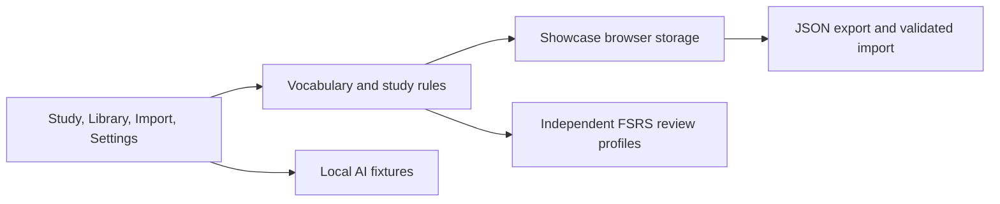

# Architecture

Mimi Vocabulary is a Next.js App Router application with React, TypeScript, Tailwind CSS, and Vitest. The runnable showcase uses browser storage. Database and paid-provider implementations remain visible as engineering examples, with no account configuration included.

## Local flow

The current learner selects a data partition in the local workspace. It is a convenience selector, not a verified identity or confidential per-person authorization boundary.

## Source map

| Owner | Responsibility |
| --- | --- |
| `src/app/` | Pages and API route entry points |
| `src/components/` | Stateful learning UI, import previews, dialogs, and recovery interactions |
| `src/lib/vocabulary/` | Vocabulary identity, imports, local repository, and backup semantics |
| `src/lib/review/` | Independent Recognition and Active review profiles using FSRS |
| `src/lib/daily-study/` | Study-day windows, goals, queue plans, prompt evidence, and answer handling |
| `src/lib/storage/` | Runtime selection, durable data contracts, and PostgreSQL implementation |
| `src/lib/ai-enrichment/` | Structured drafts, local fixtures, provider adapter, guards, and accounting |
| `src/lib/tts/` | Speech request guards, cache, provider abstraction, and accounting |
| `src/lib/security/` | Authentication and runtime-boundary examples |
| `db/migrations/` | Ordered SQL schema examples; no live migration runner |
| `scripts/` | Pure backup planning and SQL parsing with tests; synthetic fixture checks |

## Product contracts

Recognition and Active Vocabulary have separate review state, events, daily plans, and FSRS parameter sets. Say it, Spell it, and Dictation share the Active review profile while preserving the activity performed. Moving a history-bearing word to another track starts a new learning history rather than copying scheduling state.

Vocabulary identity is scoped to a learner and normalized text. New English examples require aligned Chinese translations. Imports remain editable candidates until the user commits a selected set. AI output is validated as a draft and requires explicit acceptance before it changes formal learning data.

## Persistence and uncertain outcomes

Local mode writes to browser storage. Exported JSON includes versioned application data so validation can reject incompatible or inconsistent inputs. The synthetic backup planner exercises schema mapping and referential checks without making a database connection.

The retained PostgreSQL implementation uses explicit runtime and environment guards. Remote mutations carry client compatibility and request evidence; selected operations use transaction-backed idempotency. If the browser cannot determine whether a remote save committed, recovery holds later writes, preserves the uncertainty, and rereads state before an explicit continuation. A successful read alone does not authorize replaying the old write.

## External-service boundaries

The Gemini and Google Cloud speech adapters demonstrate server-owned enablement, validated inputs, caching, provider accounting, concurrency ceilings, and kill switches. These are application controls rather than a promise about a provider's billing system. The public defaults keep cloud execution disabled. Local fixture output identifies itself as a preview and must not be represented as a live model result.

The authentication example verifies Cloudflare Access JWTs when explicitly configured. Middleware validation cannot by itself stop a hosting provider from invoking that middleware. An externally deployed version would also need an independently configured origin boundary, suitable deployment protection, and a reviewed data-authorization model. Those platform settings and credentials are absent here.

## Deployment and data scope

There is no connected cloud project, automated deployment workflow, database credential, or production data in the intended showcase package. SQL files describe schema evolution; they do not establish a migrated database. Database integration and live-provider behavior require separately scoped setup and verification. See [validation](docs/VALIDATION.md) and the [SQL reference](db/LOCAL_BACKUP_TO_POSTGRES.md).

The accepted visual language is owned by [docs/DESIGN.md](docs/DESIGN.md). Maintenance scope and publication state are owned by [docs/PLAN.md](docs/PLAN.md).
